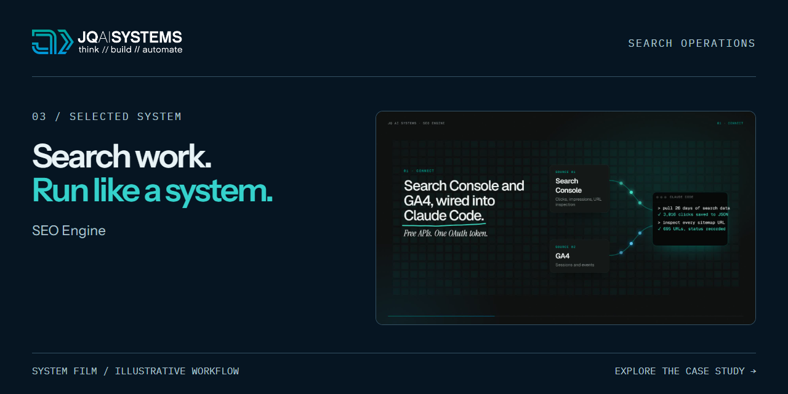
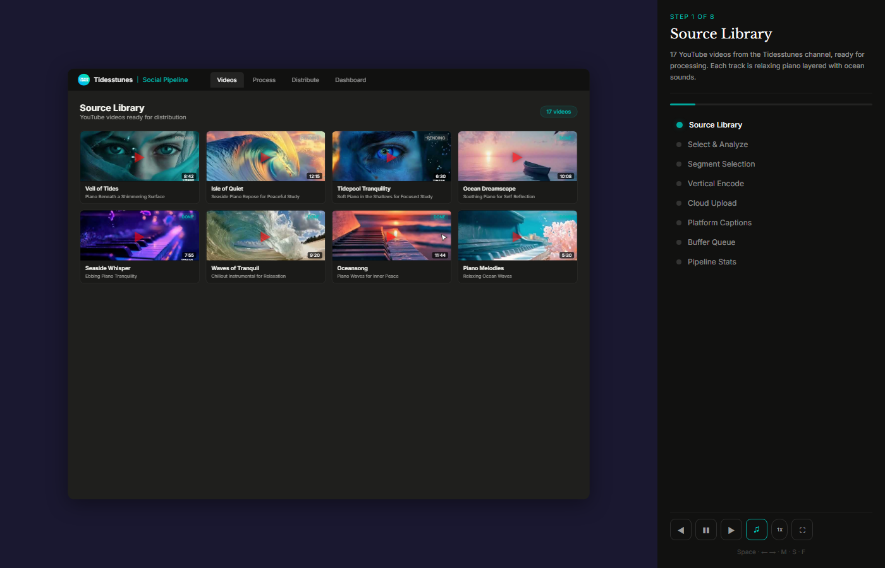
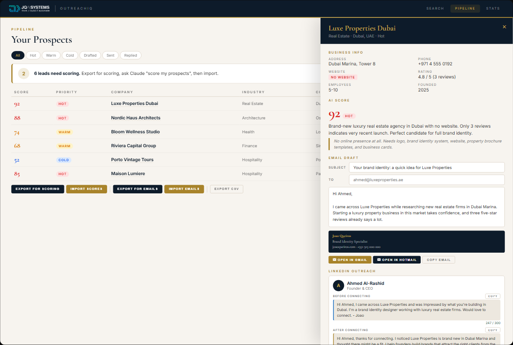
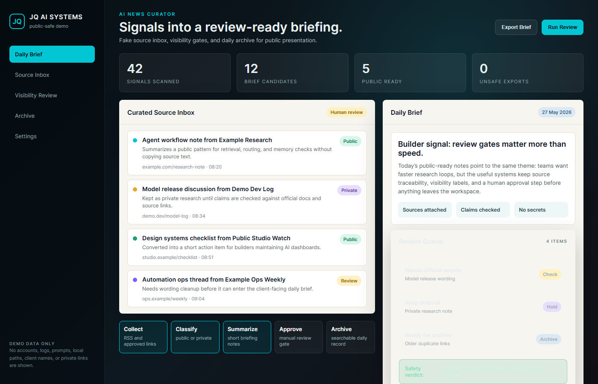
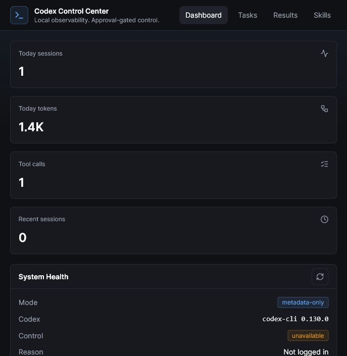

# JQ AI SYSTEMS / Public Demos

Explore the workflows: how inputs become drafts, queues, checks and reviewable outputs.

[Selected systems](https://www.ai.joaoqueiros.com/systems) · [Read the case studies](https://github.com/jqaisystems/jqai-internal-systems) · [Discuss a project](https://www.ai.joaoqueiros.com/contact)

The guided demos use sample data. System films are illustrative explanations. These public previews do not connect to private production systems.

## Websites, films and source

- **[Scrollwork](https://www.ai.joaoqueiros.com/scrollwork):** explore actual websites through scrolling interaction. [Breakdown](https://github.com/jqaisystems/jqai-internal-systems/blob/main/case-studies/scrollwork.md).
- **[Cairn](https://www.ai.joaoqueiros.com/cairn):** inspect the search-checkpoint method and public example report. [Breakdown](https://github.com/jqaisystems/jqai-internal-systems/blob/main/case-studies/cairn.md).
- **[Visions Recipes](https://github.com/jqaisystems/visions-recipes):** creative films with source and remix instructions. These are films, rather than working software demonstrations.

## Jump to a preview

[Etsy to Pinterest](#etsy-to-pinterest) · [Adobe Stock Uploader](#adobe-stock-uploader) · [SEO Engine](#seo-engine) · [Tidesstunes](#tidesstunes-social-pipeline) · [OutreachIQ](#outreachiq) · [AI News Curator](#ai-news-curator) · [Codex Control Center](#codex-control-center)

## Explore the work

### Etsy to Pinterest

Review image-pin preparation and scheduling, with a separate manual queue for video pins.

[Open demo](https://www.ai.joaoqueiros.com/demo/etsy-to-pinterest.html) · [Case study](https://www.ai.joaoqueiros.com/systems/etsy-to-pinterest) · [Watch the film](https://www.ai.joaoqueiros.com/media/systems/films/etsy-to-pinterest.mp4)

### Adobe Stock Uploader

Inspect visual batch review, ordered metadata, CSV validation and final human review.

[Open demo](https://www.ai.joaoqueiros.com/demo/adobe-stock-uploader.html) · [Case study](https://www.ai.joaoqueiros.com/systems/adobe-stock-uploader) · [Watch the film](https://www.ai.joaoqueiros.com/media/systems/films/adobe-stock-uploader.mp4)

### SEO Engine

Explore the film and case study for indexing checks, sitemap validation and dated search checkpoints.

[Case study](https://www.ai.joaoqueiros.com/systems/seo-engine) · [Watch the film](https://www.ai.joaoqueiros.com/media/systems/films/seo-engine.mp4)

### Tidesstunes Social Pipeline

Follow music-video selection, vertical clips, tailored captions and a publishing queue.

[Open demo](https://www.ai.joaoqueiros.com/demo/tidesstunes-social-pipeline.html) · [Case study](https://www.ai.joaoqueiros.com/systems/tidesstunes-social-pipeline) · [Watch the film](https://www.ai.joaoqueiros.com/media/systems/films/tidesstunes-social-pipeline.mp4)

### OutreachIQ

Inspect search, enrichment, drafting, tone checks and the human review gate.

[Open demo](https://www.outreachiq.joaoqueiros.com/demo/) · [Case study](https://www.ai.joaoqueiros.com/systems/outreach-iq)

### AI News Curator

Follow the source collection, briefing, archive and review workflow.

[Open demo](https://www.ai.joaoqueiros.com/demo/ai-news-curator.html) · [Case study](https://www.ai.joaoqueiros.com/systems/ai-news-curator)

### Codex Control Center

Explore a local-observability dashboard through fictional sample data.

[Open demo](https://jqaisystems.github.io/codex-control-center/demo/) · [Case study](https://www.ai.joaoqueiros.com/systems/codex-control-center)

## More to inspect

| Resource | What it offers |
|---|---|
| [JQ AI Skills](https://github.com/jqaisystems/jqai-ai-skills) | MIT-licensed reusable workflows, with instructions and public examples. [Latest release](https://github.com/jqaisystems/jqai-ai-skills/releases/latest). |
| [AI Brief Generator](https://www.ai.joaoqueiros.com/systems/ai-brief-generator) | A case study on turning intake into a structured creative brief. |
| [Content Calendar](https://www.ai.joaoqueiros.com/systems/content-calendar) | A case study on planning content from a brand brief. |

About the public previews

These examples show workflow behaviour and review points. Production source, private prompts, credentials and business data stay private. Read the companion case studies for the problem, approach and boundaries.

[Discuss a similar workflow](https://www.ai.joaoqueiros.com/contact) · [JQ AI SYSTEMS](https://www.ai.joaoqueiros.com)
